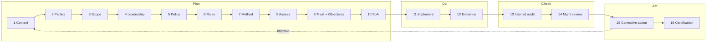

# ISO 27001 Implementation Roadmap

> **A 16-stage, evidence-driven ISMS implementation, from Clause 4 context to certification readiness, worked end to end for a fictional SaaS company.**

An ISO/IEC 27001:2022 implementation is not 50 random tasks. It is a sequence of 16 stages, each feeding the next. Get the sequence right and audit findings shrink; get it wrong and half the work is redone. This repository documents each stage (clause, activities, deliverables, exit criteria, common audit findings) and applies it to **Orbitwise Cloud Ltd**, a fictional payroll and HR SaaS provider, producing the artifacts an auditor expects: scope, risk methodology, a risk register, a 93-control Statement of Applicability, objectives, evidence register, audit report, management review and a certification go/no-go checklist.

## The roadmap



| # | Stage | Clause | Phase | Deliverable |
|---|---|---|---|---|
| 01 | [Context of the Organization](stages/01-context.md) | 4.1 | Plan | Context and Issues Register |
| 02 | [Interested Parties and Their Requirements](stages/02-interested-parties.md) | 4.2 | Plan | Interested Parties Register and Legal, Regulatory and Contractual Register |
| 03 | [ISMS Scope](stages/03-scope.md) | 4.3 (and 4.4) | Plan | ISMS Scope Statement with boundary diagram |
| 04 | [Leadership and Commitment](stages/04-leadership.md) | 5.1 | Plan | ISMS Mandate, Steering Committee Charter and signed minutes, resource approval |
| 05 | [Information Security Policy](stages/05-information-security-policy.md) | 5.2 | Plan | Information Security Policy v1.0 and a topic-policy plan |
| 06 | [Roles, Responsibilities and Authorities](stages/06-roles-responsibilities.md) | 5.3 | Plan | ISMS RACI matrix, role descriptions and competence records |
| 07 | [Risk Assessment Methodology](stages/07-risk-methodology.md) | 6.1.2 | Plan | Risk Assessment and Treatment Methodology v1.0 |
| 08 | [Risk Assessment](stages/08-risk-assessment.md) | 6.1.2, 8.2 | Plan | Asset inventory and Risk Register v1.0 |
| 09 | [Risk Treatment and Security Objectives](stages/09-risk-treatment-objectives.md) | 6.1.3, 6.2, 6.3 | Plan | Risk Treatment Plan and Information Security Objectives |
| 10 | [Statement of Applicability](stages/10-statement-of-applicability.md) | 6.1.3 d | Plan | Statement of Applicability v1.0 |
| 11 | [Control Implementation](stages/11-control-implementation.md) | 8.1, 8.3 | Do | Implemented controls, supporting policies and procedures, implementation tracker |
| 12 | [Evidence Collection](stages/12-evidence-collection.md) | 7.5, 9.1 | Do | Evidence Register and monthly ISMS scorecard |
| 13 | [Internal Audit](stages/13-internal-audit.md) | 9.2 | Check | Audit programme, audit plans, internal audit report and findings log |
| 14 | [Management Review](stages/14-management-review.md) | 9.3 | Check | Management review pack, minutes and action log |
| 15 | [Nonconformity and Corrective Action](stages/15-corrective-action.md) | 10.1, 10.2 | Act | Corrective Action Register with root cause and effectiveness checks |
| 16 | [Certification Readiness](stages/16-certification-readiness.md) | Certification process (ISO/IEC 17021-1, 27006) | Act | Readiness assessment, audit plan, audit coordination pack |

Clause 7 (support) is cross-cutting; see the [traceability matrix](docs/traceability-matrix.md).

## What is in this repository

```
.
├── README.md
├── assets/
│   ├── banner.jpg
│   └── social-banner.jpg          # 1280x640, for the GitHub social preview
├── stages/                        # 16 stage guides with worked examples
├── docs/
│   ├── dependency-map.md          # what each stage needs and produces
│   ├── traceability-matrix.md     # clause -> stage -> evidence, mandatory documents
│   ├── risk-register.csv          # 12 risks with inherent and residual scoring
│   └── soa.csv                    # Statement of Applicability, all 93 Annex A controls
```

## Highlights

- **Sequenced by dependency.** The [dependency map](docs/dependency-map.md) shows each stage's inputs, outputs and the cost of doing it out of order.
- **Traceable end to end.** Context issue, to risk, to treatment, to SoA control, to evidence, to audit finding, to corrective action.
- **Full Statement of Applicability.** 93 controls across Organizational (37), People (8), Physical (14) and Technological (34) themes, with basis for selection, status and two justified exclusions.
- **Current to Amendment 1:2024.** Climate change is considered in context and interested-party analysis; planning of changes (6.3) is covered.
- **Audit-ready framing.** Every stage ends with exit criteria and the findings certification auditors most often raise.

## How to use it

1. Read the stages in order; each links to the next.
2. Replace the Orbitwise example data with your own organization's.
3. Use the CSVs as starting registers and the checklists to test readiness.

## Standards referenced

ISO/IEC 27001:2022 (including Amendment 1:2024), ISO/IEC 27002:2022, ISO/IEC 27005, ISO/IEC 27006, ISO/IEC 17021-1, ISO 19011. Clause and control titles are paraphrased; consult the published standards for authoritative text.

## Disclaimer

Orbitwise Cloud Ltd, its people, customers and figures are fictional and illustrative. This is a portfolio project demonstrating implementation method; it is not a certified ISMS, not legal advice and not a substitute for your certification body's requirements. Audit durations, timelines and sampling depend on the organization and the certification body.


